<!-- Generated from readme/ by bin/tools/build-readme.php. Edit the sources, not this file. -->

<p align="center">
   
</p>

<h1 align="center">WP Trip Summary</h1>

<p align="center">
   <strong>Structured trip summaries, self-hosted GPS tracks and interactive maps for travel bloggers.</strong><br />
   Built for biking, hiking and train journeys. Free and open source.
</p>

<p align="center">
   <a href="https://wordpress.org/plugins/wp-trip-summary/"></a>
   <a href="https://wordpress.org/plugins/wp-trip-summary/"></a>
   <a href="https://wordpress.org/plugins/wp-trip-summary/#reviews"></a>
   <a href="https://opensource.org/licenses/BSD-3-Clause"></a>
</p>

<p align="center">
   <a href="https://plugintests.com/plugins/wporg/wp-trip-summary/latest"></a>
   <a href="https://plugintests.com/plugins/wporg/wp-trip-summary/latest"></a>
</p>

<p align="center">
   <a href="https://wordpress.org/plugins/wp-trip-summary/"><strong>Download from WordPress.org</strong></a>
   &nbsp;·&nbsp;
   <a href="https://github.com/alexboia/WP-Trip-Summary/releases"><strong>GitHub releases</strong></a>
</p>

<p align="center">
   <a href="https://vimeo.com/1238064833" target="_blank">
      
   </a>
</p>

## Why WP Trip Summary
<a name="wpts-why"></a>

Readers of a travel post want answers before they read the story: how long is the route, how much climbing does it involve, how hard is it and how do I get there? WP Trip Summary puts those answers in a clean, consistent box at the top of every trip post, next to an interactive map of the route.

- 🧭 **Every trip post becomes a route sheet.** Add distance, total climb, difficulty, seasons, surface type and more. The fields are tailored to each trip type and displayed the same way on every post.
- 🗺️ **Your GPS tracks stay on your server.** Upload a GPX, KML or GeoJSON file and it is parsed, stored and rendered by your own WordPress site. You need no third-party map service account, subscription or API key.
- ⛰️ **Interactive maps with elevation profiles.** Visitors can pan, zoom, go full screen, magnify parts of the route, see its highest and lowest points and explore the altitude profile.
- 📓 **Rider's log.** Keep a record of everyone who rode or walked the route, including dates, time spent, gear and notes. You choose which entries are public.
- 🔎 **Search-engine friendly.** Optionally add schema.org `Place` structured data (JSON-LD) to posts that have a track.
- 🌍 **Ready for your audience.** The plugin is available in English, French, German and Romanian, and it supports metric and imperial units.

## See it in action
<a name="wpts-screenshots"></a>

### The map, with the altitude profile

<p align="center">
   
</p>

### What your readers see

| Trip information | Route map |
| --- | --- |
| 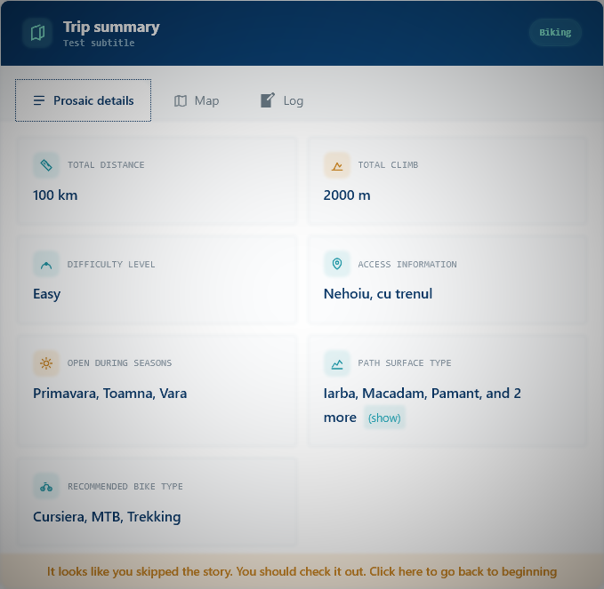 | 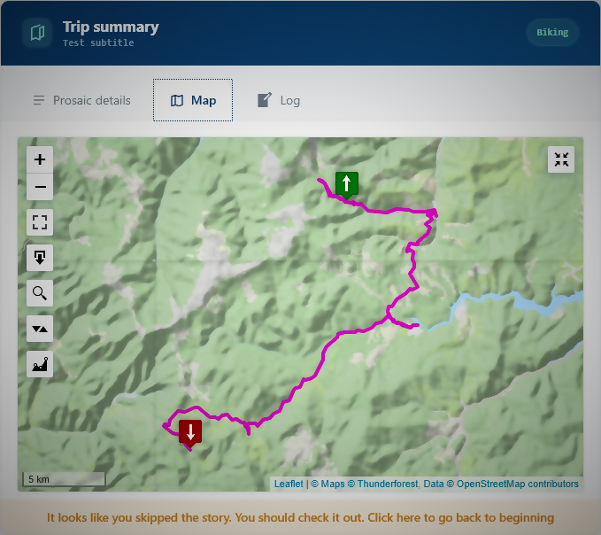 |

| Route log | Top teaser |
| --- | --- |
| 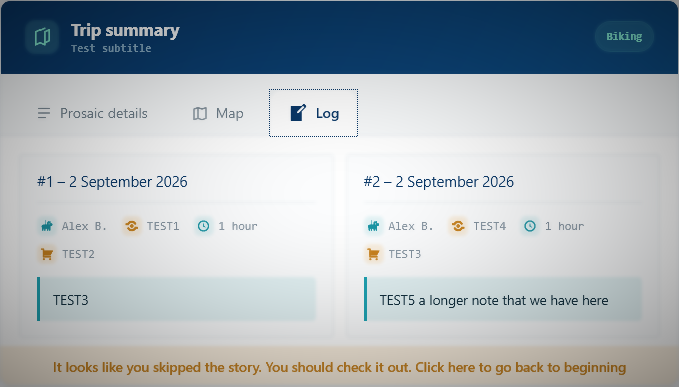 |  |

### What you work with in the editor

| Trip information | Track upload and preview |
| --- | --- |
| 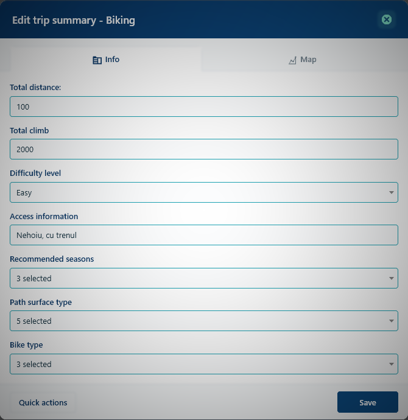 | 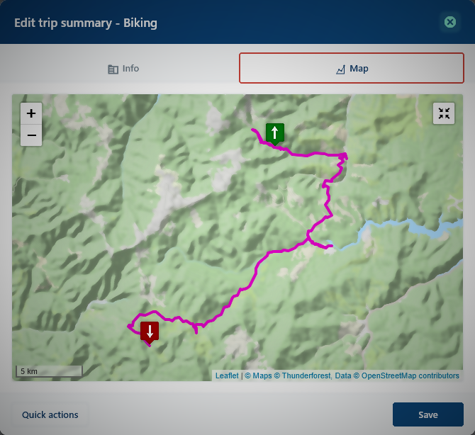 |

| Route log | Adding a route log entry |
| --- | --- |
| 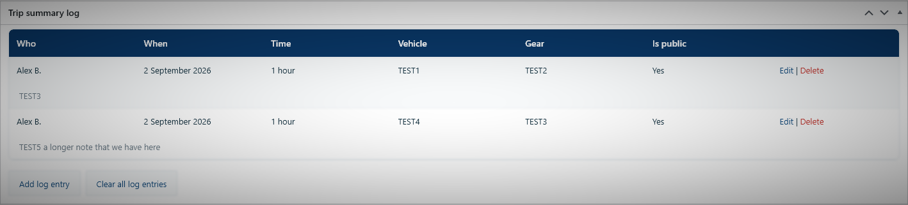 | 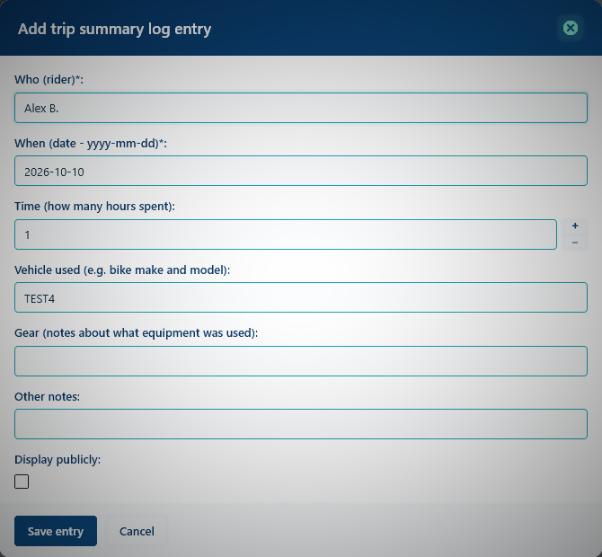 |

<details>
<summary><h3>Settings, maintenance and the rest of the admin area</h3></summary>

#### Post listing, with trip summary status and a route type filter

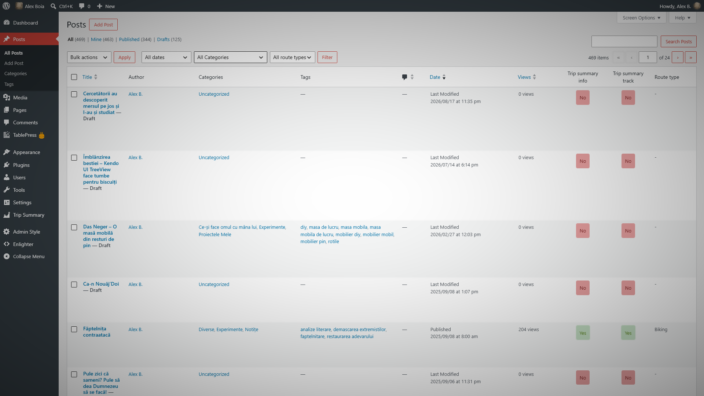

#### Audit log for a post's trip information and track

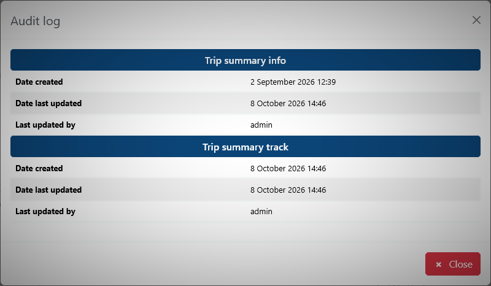

#### Viewer settings

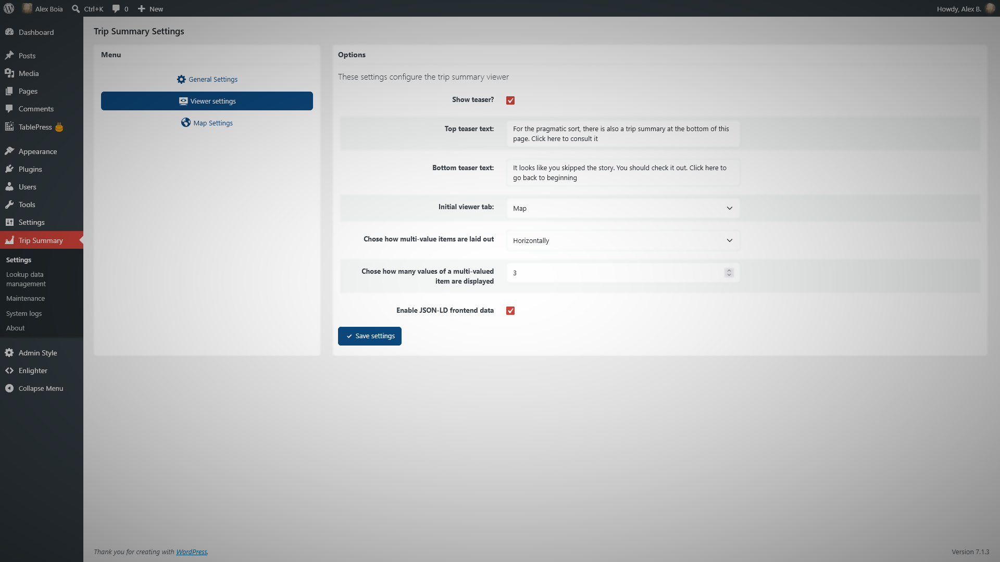

#### Map settings

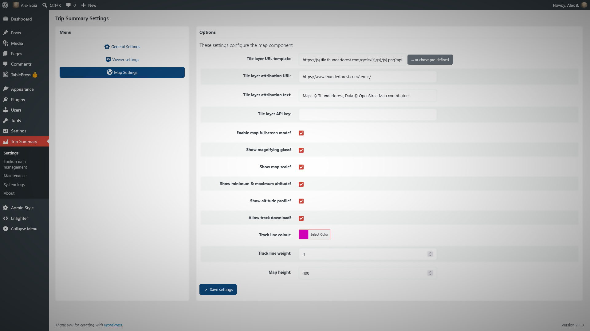

#### Pre-defined tile layers

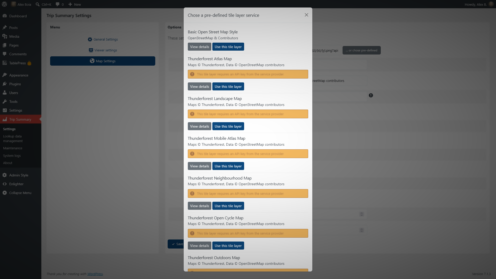

#### Lookup data management

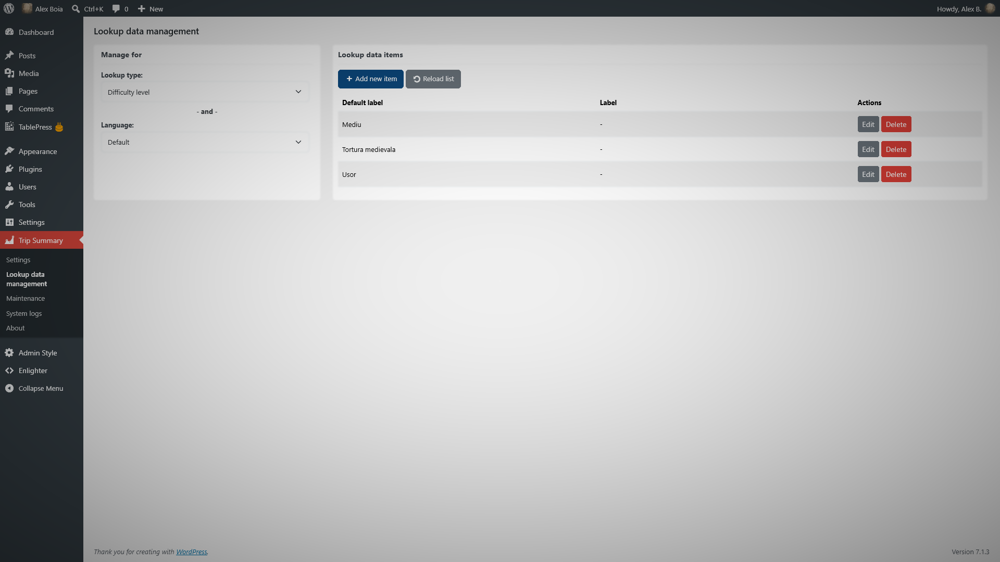

#### Maintenance - detecting missing track files

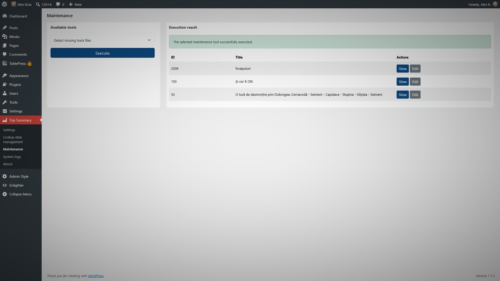

#### Maintenance - Nginx access rules for stored track files

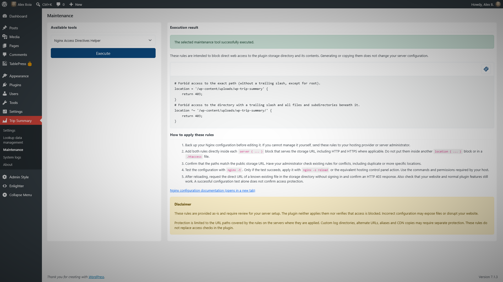

#### System logs

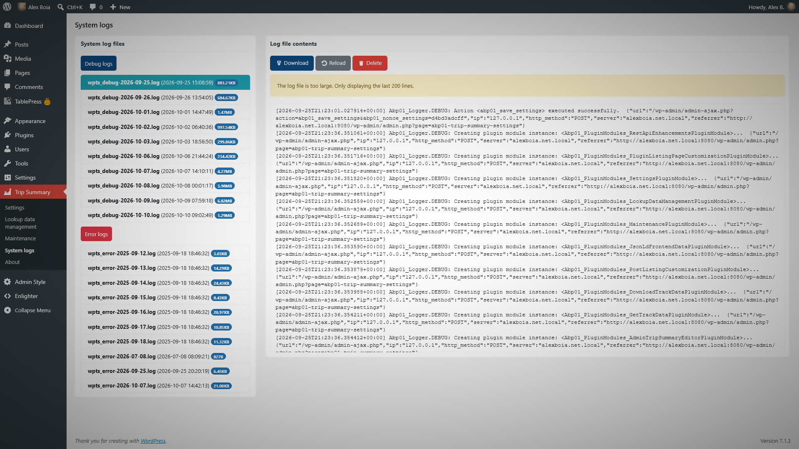
</details>

## Who it is for
<a name="wpts-audience"></a>

- **Cycling and bikepacking bloggers** who want every tour to show distance, climb, surface and recommended bike at a glance.
- **Hiking and trekking bloggers** who document trails, route markers, seasons and access routes.
- **Railway enthusiasts** who write about train journeys, including gauge, operators, electrification and line status.
- **Small tour operators, guides and outdoor clubs** that publish routes on a WordPress site and want them presented consistently.

WP Trip Summary attaches the trip information to the post itself. You write your story as usual, and the summary, map and log travel with it.

## Features
<a name="wpts-features"></a>

### Structured trip information

Choose a trip type for each post and fill in the fields that matter for it:

| Bike trips | Hiking trips | Train rides |
| --- | --- | --- |
| Total distance | Total distance | Total distance |
| Total climb | Total climb | Number of train changes |
| Difficulty level | Difficulty level | Line gauge |
| Access information | Access information | Railroad operators |
| Open during seasons | Open during seasons | Line status |
| Path surface type | Path surface type | Electrification |
| Recommended bike type | Route markers | Line type |

Options such as difficulty levels, seasons and surface types are fully editable from the admin area, in every supported language.

### GPS tracks and maps

- Upload **GPX 1.1**, **KML** or **GeoJSON (RFC 7946)** files. Every coordinate is validated before the track is saved. [See how each format is read](readme/docs/file-formats.md).
- The map is powered by [Leaflet](https://leafletjs.com/) and uses [OpenStreetMap](https://www.openstreetmap.org/) by default. You can choose a predefined tile layer or set up your own.
- Visitors can use full-screen mode, a magnifying glass and the button that re-centers the map on the track.
- An altitude profile chart and a box with the minimum and maximum altitude are available.
- You can let visitors download the track as a GPX file.
- You can change the track's color and line weight.

### Rider's log

Add as many log entries as you need to each route, with the rider, date, time spent, vehicle, gear and notes. Public entries appear in a dedicated tab of the viewer.

### Easy to place, easy to configure

- The trip summary viewer is added automatically to the post, or you can place it yourself with the `[abp01_trip_summary_viewer]` shortcode.
- A **Gutenberg block** and a **classic editor button** insert the shortcode for you.
- A **teaser** at the top of the post can invite readers to jump to the trip summary.
- You can choose the tab that the viewer opens on and the unit system (metric or imperial).

### For site owners

- In the post listing, you can **filter posts by trip type** and see a **trip summary audit log**.
- The **maintenance tools** clear cached track data, find posts with missing track files or remove all plugin data.
- The **system logs** page lets you view and manage the plugin's error and debug logs.

### For developers

- Trip summary data is exposed through the WordPress REST API, in the `wpts_trip_summary` field of posts.
- [Actions and filters are documented](https://github.com/alexboia/WP-Trip-Summary/tree/master/hook-docs), so you can customize the plugin.
- Optional JSON-LD output (schema.org `Place` with a `GeoShape` bounding box):

```html
<script type="application/ld+json">
{
	"@context": "https://schema.org",
	"@type": "Place",
	"geo": {
		"@type": "GeoShape",
		"box": "45.69152 23.72547 46.01246 25.27592"
	},
	"name": "Towards Eagle's lake"
}
</script>
```

The box is described by its south-west and north-east corners: `Lat1 Lng1 Lat2 Lng2`.

## Getting started
<a name="wpts-get-it"></a>

1. In your WordPress admin area, go to `Plugins` -> `Add New` and search for **WP Trip Summary**.
2. Click `Install Now`, then `Activate`.
3. Open a post, choose the trip type in the **Trip Summary** box, fill in the details and upload your GPS track.
4. Publish your post. The trip summary and map appear on the post.

You can fine-tune the plugin from `Trip Summary` -> `Settings`.

Prefer a manual install? Download the latest package from the [WordPress plugin directory](https://wordpress.org/plugins/wp-trip-summary/) or from [GitHub releases](https://github.com/alexboia/WP-Trip-Summary/releases), then upload it from `Plugins` -> `Add New` -> `Upload Plugin`.

## Languages
<a name="wpts-langs"></a>

| Language | Code |
| --- | --- |
| English (default) | en_US |
| French | fr_FR |
| German | de_DE |
| Romanian | ro_RO |

The German translation was partly contributed by [Nico](https://wordpress.org/support/users/nida78/).

Would you like WP Trip Summary in your language? [Open an issue](https://github.com/alexboia/WP-Trip-Summary/issues/new/choose) and help translate it.

## What's new
<a name="wpts-changelog"></a>

### Version 0.3.2

- **KML support.** Import tracks from KML files as well as GPX and GeoJSON ([#91](https://github.com/alexboia/WP-Trip-Summary/issues/91)).
- **German translation** ([#90](https://github.com/alexboia/WP-Trip-Summary/issues/90)).
- **Filter posts by trip type** in the admin post listing ([#92](https://github.com/alexboia/WP-Trip-Summary/issues/92)).
- **System logs.** The plugin now keeps error and debug logs, which you can manage from `Trip Summary` -> `System logs`.
- Updated in-plugin help for English and Romanian ([#89](https://github.com/alexboia/WP-Trip-Summary/issues/89)).
- Bug fixes and stability improvements.

[See the full changelog](https://github.com/alexboia/WP-Trip-Summary/blob/master/CHANGELOG.md).

## Roadmap
<a name="wpts-roadmap"></a>

Version 0.4 focuses on flexibility and on making the plugin your own:

- [ ] **Custom trip types**, plus new built-in ones such as road trips and water activities.
- [ ] **Viewer color schemes** that you can customize from the settings page or in code.
- [ ] **GPX waypoints** displayed on the map.
- [ ] **A public API** for plugin and theme developers.
- [ ] **More customizable settings.**

You can follow the work in the [milestones](https://github.com/alexboia/WP-Trip-Summary/milestones). Have an idea? [Suggest a feature](https://github.com/alexboia/WP-Trip-Summary/issues/new/choose).

## FAQ
<a name="wpts-faq"></a>

**Does it work with the block editor (Gutenberg)?**

Yes. The plugin works with both the block editor and the classic editor.

**Do I need an account with a map provider?**

No. The map uses OpenStreetMap tiles by default, and your tracks are stored on your own server. You can switch to another tile provider if you want to.

**Which GPS file formats can I upload?**

You can upload GPX 1.1, KML and GeoJSON files. [See the parsing details](readme/docs/file-formats.md).

**Can my readers download the track?**

Yes, if you allow it. Track downloads are optional and can be turned on from the plugin settings.

**Can I show the trip summary somewhere else in the post?**

Yes. Use the `[abp01_trip_summary_viewer]` shortcode, the Gutenberg block or the classic editor button. The shortcode takes no parameters and is supported once per post, in the post for which the trip summary was defined.

**Can I use it with post types other than posts and pages?**

Yes, with a filter hook. [See the example in the wiki](https://github.com/alexboia/WP-Trip-Summary/wiki/Changing-the-editor-availability-per-post-type).

**Why doesn't the trip summary appear on archive pages?**

The viewer is shown only on the post's own page. It does not appear on listing pages, such as archives, even when they display the full post content.

**Does it support multisite installations?**

WP Trip Summary is designed and tested for single-site installations. Multisite is not officially supported.

**Is it free?**

Yes. WP Trip Summary is free and open source, under the BSD 3-Clause license.

## Requirements
<a name="wpts-requirements"></a>

- WordPress 6.0 or newer
- PHP 8.0 or newer, with the `libxml`, `SimpleXML` and `mysqli` extensions
- MySQL 5.7 or newer, with spatial support
- Recommended: the `mbstring` and `zlib` PHP extensions

Developer setup and test instructions are in [CONTRIBUTING.md](https://github.com/alexboia/WP-Trip-Summary/blob/master/CONTRIBUTING.md).

## Support and community
<a name="wpts-contributing"></a>

- 🐞 **Found a bug or have a question?** [Open an issue](https://github.com/alexboia/WP-Trip-Summary/issues/new/choose) or use the [WordPress.org support forum](https://wordpress.org/support/plugin/wp-trip-summary/).
- ⭐ **Enjoying the plugin?** A [review on WordPress.org](https://wordpress.org/support/plugin/wp-trip-summary/reviews/#new-post) helps other travel bloggers find it.
- 🛠️ **Want to contribute code or translations?** [Read the contribution guide](https://github.com/alexboia/WP-Trip-Summary/blob/master/CONTRIBUTING.md).

### Support the project

WP Trip Summary is built and maintained in my free time. If it helps you share your journeys, you can support its development:

[](https://ko-fi.com/Q5Q01KGLM)

You can also support my paid work on [Gumroad](https://alexboia.gumroad.com/).

## License
<a name="wpts-license"></a>

WP Trip Summary is free and open source, released under the [BSD 3-Clause License](https://opensource.org/licenses/BSD-3-Clause).
